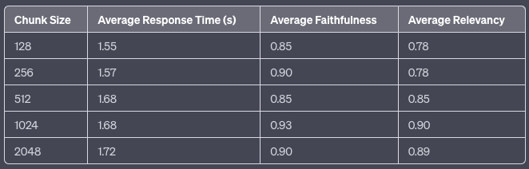
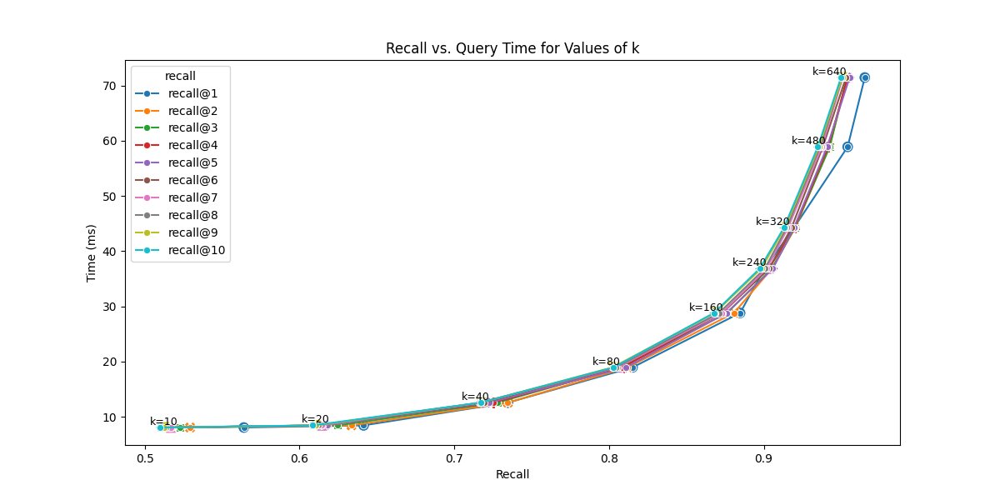
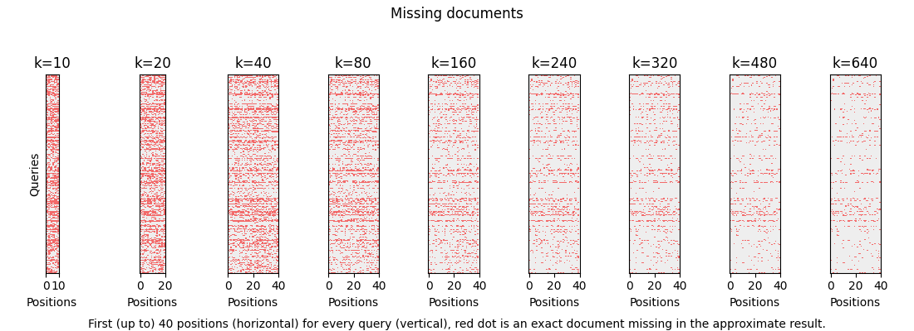

<!-- SDA-AIE-311 ADD (LangChain conversion) -->

# A. Why Chunking Matters {.sdaia-dark background-gradient="linear-gradient(135deg, #1C355E, #00C9A7)"}
## Agenda

- **A. Why Chunking Matters** — The foundational trade-off
- **B. Fixed-Size Chunking** — The baseline approach
- **C. Document-Aware Chunking** — Respecting structure
- **D. Semantic Chunking** — Grouping by meaning
- **E. Vector Store Landscape** — Where vectors live
- **F. Indexing: Brute Force → ANN** — Why search needs an index
- **G. Vector Store Manager** — Building the storage layer
- **H. The RAG Service** — Retrieve → Augment → Generate

One of the most impactful decisions in RAG quality

## The Library Analogy

:::: {.columns}

::: {.column width="50%"}
**Chunks Too Small**

Like tearing pages in half and filing them separately.

- Retriever finds a fragment
- Missing context and meaning
- LLM can't make sense of it
:::

::: {.column width="50%"}
**Chunks Too Large**

Like filing whole chapters together.

- Retriever returns a heavy tome
- Answer buried in irrelevant text
- Wastes tokens and increases cost
:::

::::

::: {.callout-important}
## The Goal
The optimal chunk is the **smallest unit** that contains a **complete, self-contained idea**.
:::

## Chunk Size Trade-off



> SOURCE: [LlamaIndex Blog](https://www.llamaindex.ai/blog/evaluating-the-ideal-chunk-size-for-a-rag-system-using-llamaindex-6207e5d3fec5). Empirical results showing how chunk size affects response time, faithfulness, and relevancy.

## The Complete Idea Rule

::: {.callout-tip}
## Golden Rule of Chunking
A chunk should be **meaningful on its own**. If someone read only that chunk, would they understand the point?

- For a research paper → a section or subsection
- For a legal contract → a clause
- For code → a complete function
:::

> **Production Tip:** Always log your average chunk size and count. A sudden spike can indicate a formatting issue in your source data.

# B. Fixed-Size Chunking {.sdaia-dark background-gradient="linear-gradient(135deg, #1C355E, #FF7A5C)"}
The fast, deterministic baseline

## How It Works {.smaller}

::: {.flow}
::: {.flow-step .accent-navy}
[Full Document]{.t}
[(10,000 chars)]{.s}
:::
::: {.flow-arrow}
&rarr;
:::
:::: {.flow-branch}
::: {.flow-step .accent-teal}
[Chunk 1]{.t}
[(0-500)]{.s}
:::
::: {.flow-step .accent-orange}
[Chunk 2]{.t}
[(400-900)]{.s}
:::
::: {.flow-step .accent-purple}
[Chunk 3]{.t}
[(800-1300)]{.s}
:::
::: {.flow-step .accent-teal}
[&hellip;]{.t}
[(overlap)]{.s}
:::
::::
:::

**Key parameters:** `chunk_size` (characters) and `chunk_overlap` (sliding window)

## Sliding Window {auto-animate=true}

::: {style="font-size: 0.9em;"}
```
Document: |████████████████████████████████████████|

Chunk 1:  |████████|                                  chunk_size = 500
Chunk 2:       |████████|                             overlap = 100
Chunk 3:            |████████|
Chunk 4:                 |████████|
```
:::

. . .

**Why overlap?**

- Prevents ideas from being cut at boundaries
- Chunk 1 ends mid-sentence → overlap captures the rest in Chunk 2
- Typical overlap: **10-20%** of chunk size

## Code: FixedSizeChunker

```python
class FixedSizeChunker(BaseChunker):
    """Splits text into fixed-size chunks with overlap."""

    def chunk_document(self, document_text, metadata=None):
        chunks = []
        step_size = self.chunk_size - self.chunk_overlap
        start = 0

        while start < len(document_text):
            end = min(start + self.chunk_size, len(document_text))
            chunk_text = document_text[start:end]

            if chunk_text.strip():
                chunks.append(self._create_chunk_dict(
                    chunk_text, metadata, len(chunks)))

            start += step_size
        return chunks
```

## When Fixed-Size Works

| Scenario | Why It Works |
|----------|-------------|
| **Uniform text** (news articles, chat logs) | Consistent structure, no sections |
| **Quick prototyping** | Fast to implement, no dependencies |
| **Baseline comparison** | Always test against this first |
| **Code files** | Functions are roughly uniform length |

::: {.callout-tip}
## Starting Point
`chunk_size=800`, `chunk_overlap=150` is a solid baseline.
:::

## Characters ≠ Tokens: The Truncation Trap

:::: {.columns}

::: {.column width="50%"}
::: {.cardbox .purple}
❌ **The Problem**

```
chunk_size = 1,800 chars
model limit = 512 tokens
avg token  ≈ 3 chars

→ 1,800 ÷ 3 = ~600 tokens
→ 600 − 512 = 88 tokens dropped
```

**No error. No warning. Just lost meaning.**
:::
:::

::: {.column width="50%"}
::: {.cardbox .teal}
✅ **The Fix**

- Measure chunk size in **tokens**, not characters
- Use the model's tokenizer (e.g. `tiktoken`) to count before storing
- Keep chunks ≤ **90 % of the model's token limit** as a safety margin
:::
:::

::::

::: {.callout-warning}
## Silent failure
`text-embedding-ada-002` has a **8,191-token** limit; `all-MiniLM-L6-v2` only **256 tokens**. A 500-char chunk is safe for the former but can overflow the latter.
:::

# C. Document-Aware Chunking {.sdaia-dark background-gradient="linear-gradient(135deg, #1C355E, #9B8EC0)"}
Respecting natural boundaries

## The Problem with Fixed-Size {.code-shrink} 

Fixed-size chunking counts characters blindly.

:::: {.columns}

::: {.column width="50%"}
::: {.cardbox .purple}
❌ **Fixed-Size** — boundary lands mid-word

```text
Chunk 3: "...voltage regulation.
1.1 Background
Previous work used fixed-size ch"

Chunk 4: "unks. This often cuts sentences.
We propose a semantic method..."
```

:::
:::

::: {.column width="50%"}
::: {.cardbox .teal}
✅ **Recursive** — splits on `\n\n` first

```text
Chunk 3: "1.1 Background
Previous work used fixed-size chunks.
This often cuts sentences.
We propose a semantic method."


```

:::
:::
::::

::: {.callout-important}
## Why it hurts retrieval
A query for *"Background on fixed-size chunking"* must now match two chunks instead of one. Both will score lower than a single coherent chunk — you lose precision **and** context.
:::

## Recursive Splitting

Try the coarsest separator first; fall back to finer ones only when a chunk is still too large.

<svg viewBox="0 0 1020 400" width="100%" xmlns="http://www.w3.org/2000/svg" role="img" aria-label="Recursive splitting: a full document is tried against paragraph, then line, then sentence separators; each attempt exits to Done when the chunks are small enough, and falls through to the next finer separator when they are still too large; splitting by word always ends at Done.">
  <defs>
    <marker id="rec-arrow" viewBox="0 0 10 10" refX="9" refY="5" markerWidth="6" markerHeight="6" orient="auto-start-reverse">
      <path d="M 0 0 L 10 5 L 0 10 z" fill="var(--sdaia-navy)"/>
    </marker>
  </defs>
  <g fill="none" stroke="var(--sdaia-navy)" stroke-width="2.5" marker-end="url(#rec-arrow)">
    <path d="M 190 51 H 236"/>
    <path d="M 300 84 V 111"/>
    <path d="M 300 179 V 206"/>
    <path d="M 300 274 V 301"/>
    <path d="M 520 51 H 620 V 166 H 736"/>
    <path d="M 520 146 H 655 V 179 H 736"/>
    <path d="M 520 241 H 690 V 192 H 736"/>
    <path d="M 520 336 H 715 V 205 H 736"/>
  </g>
  <g font-size="14" fill="var(--muted)" font-family="inherit">
    <text x="312" y="103">Still too large</text>
    <text x="312" y="198">Still too large</text>
    <text x="312" y="293">Still too large</text>
    <text x="534" y="42">Chunks OK</text>
    <text x="534" y="137">Chunks OK</text>
    <text x="534" y="232">Chunks OK</text>
  </g>
  <g stroke="var(--sdaia-navy)" stroke-width="2.5">
    <rect x="10" y="20" width="180" height="62" rx="12" fill="var(--sdaia-navy)"/>
    <rect x="240" y="20" width="280" height="62" rx="12" fill="var(--sdaia-teal-on-dark)"/>
    <rect x="240" y="115" width="280" height="62" rx="12" fill="var(--sdaia-coral-on-dark)"/>
    <rect x="240" y="210" width="280" height="62" rx="12" fill="var(--sdaia-purple-on-dark)"/>
    <rect x="240" y="305" width="280" height="62" rx="12" fill="var(--sdaia-teal-on-dark)"/>
    <rect x="740" y="150" width="180" height="70" rx="12" fill="var(--sdaia-navy)"/>
  </g>
  <g font-size="17" font-weight="700" text-anchor="middle" font-family="inherit">
    <text x="100" y="57" fill="#ffffff">Full Document</text>
    <text x="380" y="44" fill="#101820">Try split by</text>
    <text x="380" y="68" fill="#101820">paragraph (&#92;n&#92;n)</text>
    <text x="380" y="139" fill="#101820">Try split by</text>
    <text x="380" y="163" fill="#101820">line (&#92;n)</text>
    <text x="380" y="234" fill="#101820">Try split by</text>
    <text x="380" y="258" fill="#101820">sentence (. )</text>
    <text x="380" y="329" fill="#101820">Split by</text>
    <text x="380" y="353" fill="#101820">word ( )</text>
    <text x="830" y="192" fill="#ffffff">Done</text>
  </g>
</svg>

## Code: RecursiveChunker — Split {.smaller}

```python
class RecursiveChunker(BaseChunker):
    """Keep paragraphs/sentences/words intact — pure Python, no deps."""

    def __init__(self, chunk_size=500, chunk_overlap=50,
                 separators=None):
        super().__init__(chunk_size, chunk_overlap)
        self.separators = separators or ["\n\n", "\n", ". ", " ", ""]

    def _split(self, text, seps):
        """Recurse to a finer separator only while a piece is too big."""
        sep, rest = seps[0], seps[1:]
        pieces = list(text) if sep == "" else text.split(sep)
        out = []
        for i, p in enumerate(pieces):
            piece = p + sep if (sep and i < len(pieces) - 1) else p
            if not piece:
                continue
            if len(piece) <= self.chunk_size or not rest:
                out.append(piece)                      # fits — keep it
            else:
                out.extend(self._split(piece, rest))   # recurse finer
        return out
```

## Code: RecursiveChunker — Merge {.smaller}

```python
    def _merge(self, pieces):
        """Pack pieces up to chunk_size, carrying overlap forward."""
        chunks, cur = [], ""
        for p in pieces:
            if cur and len(cur) + len(p) > self.chunk_size:
                chunks.append(cur)
                cur = cur[-self.chunk_overlap:] if self.chunk_overlap else ""
            cur += p
        if cur.strip():
            chunks.append(cur)
        return chunks

    def chunk_document(self, document_text, metadata=None):
        pieces = self._split(document_text, self.separators)
        text_chunks = self._merge(pieces)
        return [self._create_chunk_dict(text, metadata, i)
                for i, text in enumerate(text_chunks)]
```

> Same idea as LangChain's `RecursiveCharacterTextSplitter`: split on the coarsest separator that fits, then greedily merge with overlap — but with **no third-party dependency**.

## Head-to-Head Comparison

| Aspect | Fixed-Size | Recursive |
|--------|:---:|:---:|
| **Speed** | ✅ Fastest | ✅ Fast |
| **Structure Awareness** | ❌ None | ✅ Paragraph / section |
| **Sentence Splitting** | ❌ Frequent | ✅ Rare |
| **Extra Dependencies** | ✅ None | ✅ None |
| **Best For** | Uniform text | Structured documents |

> **Default recommendation:** start with recursive splitting — it's the production workhorse and, as shown, needs no extra libraries. Switch to fixed-size only if your content is truly uniform.

# D. Semantic Chunking {.sdaia-dark background-gradient="linear-gradient(135deg, #1C355E, #00C9A7)"}
Using AI to find natural boundaries

## Group by Meaning

::: {style="font-size: 1.1em;"}
Instead of splitting by character count or document structure, we split where the **meaning changes**.
:::

. . .

**The Algorithm:**

1. Split text into sentences
2. Embed each sentence
3. Compute cosine distance between adjacent sentences
4. Split where distance exceeds a threshold

> When two consecutive sentences are "about different things," the cosine distance spikes.

## Distance Plot

```{python}
#| echo: false
#| fig-align: center
import numpy as np
import matplotlib.pyplot as plt

NAVY, TEAL, CORAL = "#1C355E", "#00C9A7", "#FF7A5C"
np.random.seed(7)
n = 30
distances = np.random.beta(2, 5, n) * 0.5      # synthetic, offline — no model
distances[[7, 14, 22]] = [0.42, 0.38, 0.45]    # inject a few topic shifts
threshold = np.percentile(distances, 90)
is_split = distances > threshold               # one rule, shared by both plots

fig, ax = plt.subplots(figsize=(9, 4.2))
ax.bar(range(n), distances,
       color=[CORAL if s else TEAL for s in is_split], alpha=0.9)
ax.axhline(threshold, color=NAVY, ls="--", lw=2,
           label=f"threshold (p90 = {threshold:.2f})")
for i, d in enumerate(distances):
    if is_split[i]:
        ax.annotate("split", (i, d), textcoords="offset points",
                    xytext=(0, 6), ha="center", fontsize=8,
                    color=CORAL, fontweight="bold")
ax.set_xlabel("sentence-pair index")
ax.set_ylabel("cosine distance")
ax.legend(loc="upper right", frameon=False)
ax.spines[["top", "right"]].set_visible(False)
fig.tight_layout()
plt.show()
```

**Cosine Distance** ($Distance = 1 - Similarity$): tall bars = adjacent sentences about different things. Bars above the threshold line = **topic shifts** → split points.

## The Threshold Dilemma

**The Problem:**

- How do you pick a fixed value for "different enough"?
- 0.5 might be a minor shift in one doc, but a major shift in another.
- Embedding distributions vary by **Model** and **Content**.

. . .

> So what number do we pick? Don't guess — let the document's **own gaps** decide.

## Building the Threshold from the Data 

We have one **distance** per *gap* between adjacent sentences. We only want the **biggest** gaps to be splits. What about?

:::: {.columns}

::: {.column width="42%" .incremental}
1. **Sorting** the gaps, smallest → largest.
2. Take the **biggest** gaps, let's say the **top 10%** gaps.
3. **Walk 90% across** the sorted gaps and **read the height** there. That value is our **threshold**.
4. Split only where a gap sits **above** that line — the coral bars.
:::

::: {.column width="58%"}
```{python}
#| echo: false
#| fig-align: center
import numpy as np
import matplotlib.pyplot as plt

# Reuse distances, threshold, is_split defined on the Distance Plot slide.
order = np.argsort(distances)                   # sort smallest → largest
s = distances[order]
split_sorted = is_split[order]                  # value-based: matches Distance Plot
mark = 0.9 * (n - 1)                            # the 90% position across n bars

fig, ax = plt.subplots(figsize=(7.6, 4.6))
ax.bar(range(n), s,
       color=[CORAL if v else TEAL for v in split_sorted], alpha=0.9)
ax.axvline(mark, color=NAVY, ls="--", lw=1.5)
ax.axhline(threshold, color=NAVY, ls="--", lw=1.5)
ax.annotate(f"threshold = {threshold:.2f}", xy=(mark, threshold),
            xytext=(2, threshold + 0.12), color=NAVY, fontweight="bold",
            arrowprops=dict(arrowstyle="->", color=NAVY))
ax.text(mark - 0.6, 0.005, "walk 90% across ", color=NAVY,
        ha="right", va="bottom", fontsize=10, fontweight="bold")
ax.set_xlabel("sentence-pairs, sorted by distance")
ax.set_ylabel("cosine distance")
ax.spines[["top", "right"]].set_visible(False)
fig.tight_layout()
plt.show()
```
:::

::::

## Naming the Technique

Have you recognized the steps of this technique from the previous slide?

. . . 

:::{.r-fit-text .teal}
**Percentile**
:::
. . .

In python's numpy percentile function: 

```python
threshold = np.percentile(distances, 90)   # value at the 90% mark
```


## Code: SemanticChunker

```python
class SemanticChunker(BaseChunker):
    def __init__(self, chunk_size=500, chunk_overlap=50,
                 embedding_model_name='all-MiniLM-L6-v2',
                 percentile_threshold=90):
        super().__init__(chunk_size, chunk_overlap)
        self.percentile_threshold = percentile_threshold
        self.embedding_model = SentenceTransformer(
            embedding_model_name)

    def chunk_document(self, document_text, metadata=None):
        sentences = [s.strip() for s in
                     document_text.split('. ') if s.strip()]
        embeddings = self.embedding_model.encode(sentences)
        distances = self._calculate_cosine_distances(embeddings)
        threshold = np.percentile(
            distances, self.percentile_threshold)
        # Split where distance > threshold
        ...
```

## Percentile Threshold

| Percentile | Effect | Use When |
|:---:|--------|----------|
| **80** | More splits → smaller chunks | Short documents, high precision needed |
| **90** | Balanced (default) | General-purpose, research papers |
| **95** | Fewer splits → larger chunks | Long-form content, narrative text |

::: {.callout-important}
## Cost Warning
Semantic chunking requires embedding every sentence. Use it for **high-value documents** during offline ingestion — never in real-time query paths.
:::

## Decoupling Retrieval from Context {.smaller}

::: {style="font-size: 1.1em; margin-bottom: 0.4em;"}
**Search on a small chunk; feed the LLM a big one.** The chunk you *retrieve on* doesn't have to be the chunk you *send to the model*.
:::

:::: {.columns}

::: {.column width="40%"}
**The tension — one chunk can't be both:**

- **Small** chunks → **precise** retrieval, but too little context for the LLM.
- **Large** chunks → **rich context**, but noisy, imprecise retrieval.

So split the two jobs.
:::

::: {.column width="60%"}
**Parent-document retriever**

::: {.flow}
::: {.flow-step .accent-navy}
[🔍 Query]{.t}
:::
::: {.flow-arrow}
&rarr;
:::
::: {.flow-step .accent-purple}
[Child chunk]{.t}
[(small, embedded)]{.s}
:::
::: {.flow-arrow}
&rarr;
[parent_id lookup]{.s}
:::
::: {.flow-step .accent-teal}
[Parent section]{.t}
[(large, contextual)]{.s}
:::
::: {.flow-arrow}
&rarr;
:::
::: {.flow-step .accent-orange}
[🤖 LLM]{.t}
:::
:::

- **Embed & search** the small **child** chunk → precision
- Look up its **`parent_id`** → fetch the full **parent** section → context
- Send the **parent** to the LLM
:::

::::

::: {.callout-tip}
## Implementation
Store a `parent_id` in each child chunk's metadata. After retrieval, fetch and de-duplicate parents before building the prompt. LangChain's `ParentDocumentRetriever` ships this out of the box; it's also trivial to hand-roll.
:::

## Contextual Retrieval

A chunk ripped from its document loses what *"it"* and *"the company"* referred to — so it embeds and ranks poorly.

. . .

**Contextual Retrieval** ([Anthropic, 2024](https://www.anthropic.com/news/contextual-retrieval)) prepends a short, LLM-generated blurb situating each chunk in its source **before** embedding:

```text
[Context] This chunk is from ACME's 2023 10-K, in the section on
revenue. The prior quarter's revenue was $314M.
---
Revenue grew 3% over the previous quarter.
```

# E. Vector Store Landscape {.sdaia-dark background-gradient="linear-gradient(135deg, #1C355E, #00C9A7)"}
Choosing where your vectors live

## Why Specialized Databases?

Regular databases weren't built for similarity search over high-dimensional vectors.

. . .

::: {.fragment .fade-in-then-semi-out}
**SQL Database:** "Find rows where `id = 42`" — exact match, indexed by B-tree
:::

::: {.fragment .fade-in-then-semi-out}
**Vector Database:** "Find the 5 most similar vectors to this 1536-dimensional point" — approximate nearest neighbor search
:::

::: {.fragment .fade-in}
**The key difference:** Vector DBs are built around a specialized **index** that trades small accuracy losses for **massive** speed gains — we unpack how that index works next.
:::

## Comparison Table

| Store | Type | Scale | Managed? | Best For | Cost |
|-------|------|:---:|:---:|----------|:---:|
| **ChromaDB** | Local/Server | ~1M | Self-hosted | Prototyping, small datasets | Free |
| **Pinecone** | Cloud-native | Billions | Fully | Enterprise-ready RAG | Usage-based* |
| **Weaviate** | Hybrid | Millions | Both | Flexibility, hybrid search | Free/Cloud |
| **pgvector** | PG extension | Millions | Self | Existing Postgres users | Free |

::: {.aside}
*Pinecone Serverless has no fixed monthly fee; pay only for storage and compute.
:::

## Our Choice: ChromaDB

::: {.callout-tip}
## Why ChromaDB for Development
1. **Zero operational overhead** — no cloud account needed
2. **Runs locally** — no network dependency
3. **Good performance** up to ~1M vectors
4. **Python-native API** — simple and intuitive

For production at scale → evaluate Pinecone, Weaviate Cloud or Qdrant ... etc.
:::

# F. Indexing: Brute Force → ANN {.sdaia-dark background-gradient="linear-gradient(135deg, #1C355E, #9B8EC0)"}
Why search needs an index at all

## The Indexing Problem

The brute-force retriever you built and baselined compared the query against **every** chunk vector. That's a "flat" index — exact, and the baseline every optimization here is measured against.

. . .

::: {.fragment .fade-in-then-semi-out}
**The cost:** one query at 1M vectors × 1536 dims ≈ **1.5 billion** multiply-adds. Double the corpus, double the work — cost grows **linearly** with the collection.
:::

::: {.fragment .fade-in}
::: {.callout-warning}
## Fine at thousands, hopeless at millions
Brute force is the right default for a few thousand vectors. At millions-to-billions with sub-100ms latency targets, scanning everything per query simply doesn't fit the budget. We need to **not look at most of the data.**
:::
:::

## The ANN Bargain

**Approximate Nearest Neighbor (ANN)** search trades a sliver of correctness for orders-of-magnitude speed — stop demanding the *exact* nearest neighbours.

. . .

:::: {.columns}

::: {.column width="48%"}
**The new quality metric: recall**

- **Recall** = fraction of the *true* top-K the index returns
- Production runs at **~95–99%** recall
:::

::: {.column width="52%"}
**The trade-off space**

Every index balances four forces:

- **Recall** ↔ **Latency** (the headline trade-off)
- **Memory** footprint
- **Build time**

Tuning = moving along these axes.
:::

::::


## Speed vs Accuracy: The Frontier {.smaller}

:::: {.columns}

::: {.column width="50%"}


> SOURCE: [OpenSource Connections (2025)](https://opensourceconnections.com/blog/2025/02/27/vector-search-navigating-recall-and-performance/). The Pareto frontier for HNSW: raising `ef_search` or `k` buys recall and pays in latency.
:::

::: {.column width="50%"}


> SOURCE: [OpenSource Connections (2025)](https://opensourceconnections.com/blog/2025/02/27/vector-search-navigating-recall-and-performance/). Red dots are exact documents the approximate search missed — they thin out as search depth grows.
:::

::::

::: {.notes}
This is the slide that makes the previous one concrete. As you raise ef_search — or ask for more neighbours, k — recall climbs but so does latency: roughly 50% recall at 8 ms up to ~95% at 70 ms in these published runs. There is no magic setting; you are choosing an operating point on a curve. The right-hand panel is the same story told per-query: each red dot is a document the exact search would have returned and the approximate one dropped. Both charts are reported numbers from OpenSource Connections, not measurements from this kit — your own frontier depends on your data, your embedding model and your hardware. Tie it back to the HNSW config you set in section G.
:::

## Families of ANN Indexes

Three broad strategies for not scanning everything:

| Family | Idea | Recall@Speed | Memory | Notes |
|--------|------|:---:|:---:|-------|
| **Flat** | Compare to all (no index) | Exact, slow | Low | Baseline; great < ~10K vectors |
| **IVF / Cluster** | Partition into cells; probe a few nearest | Good | Low–Med | Probe nearest cells (`nprobe`); **trains** centroids first |
| **Graph / HNSW** | Navigable graph; hop toward the query | **Best** | Higher | Inserts self-build the graph; no training pass |

::: {.fragment .fade-in}
::: {.callout-tip}
## Why HNSW is the default
**Graph methods lead the recall-vs-latency frontier** and need **no training pass** — vectors slot straight in, so the index grows with your data instead of being fit up front. That's why ChromaDB and most vector DBs default to **HNSW**.
:::
:::

## What "Training" an Index Means

**"Training" an index ≠ model training** — no gradient descent, no labels. It's a one-time pass over a *sample* of your vectors to fit the index's **structure**, *before* any data is added.

. . .

:::: {.columns}

::: {.column width="50%"}
**IVF** — runs k-means on a sample to place cell **centroids**, *then* adds each vector to the nearest cell (two phases).
:::

::: {.column width="50%"}
**HNSW** — **no training phase**: you insert, and the graph organises itself as it grows.
:::

::::

. . .

::: {.callout-note}
## Don't conflate three things
**Training** fits the structure up front · **indexing / building** inserts your vectors · **reindexing** rebuilds from scratch (new model, metric, or `M`). You'll call `index.train()` on IVF in the optimization session.
:::

# G. Vector Store Manager {.sdaia-dark background-gradient="linear-gradient(135deg, #1C355E, #9B8EC0)"}
Building the storage layer

## Architecture

::: {.card-dark .tight .center}
**VectorStoreManager**
:::

:::: {.columns}

::: {.column width="33%"}
::: {.flow .flow-col}
::: {.flow-step .accent-teal}
[ChromaDB Client]{.t}
:::
::: {.flow-arrow}
&darr;
:::
::: {.flow-step}
[Persistent Storage]{.t}
[`./data/vector_store`]{.s}
:::
:::
:::

::: {.column width="34%"}
::: {.flow .flow-col}
::: {.flow-step .accent-orange}
[Collection with HNSW]{.t}
:::
::: {.flow-arrow}
&darr;
:::
::: {.flow-step}
[`add_documents()`]{.t}
:::
::: {.flow-step}
[`search()`]{.t}
:::
::: {.flow-step}
[`get_collection_stats()`]{.t}
:::
:::
:::

::: {.column width="33%"}
::: {.flow .flow-col}
::: {.flow-step .accent-purple}
[Embedding Function]{.t}
:::
:::
:::

::::

## Init + HNSW Config

```python
class VectorStoreManager:
    def __init__(self, persist_directory="./data/vector_store",
                 collection_name="research_papers"):
        # Persistent client — survives restarts
        self.client = chromadb.PersistentClient(
            path=persist_directory,
            settings=Settings(anonymized_telemetry=False)
        )

        # Collection with optimized HNSW
        self.collection = self.client.get_or_create_collection(
            name=collection_name,
            metadata={
                "hnsw:space": "cosine",
                "hnsw:construction_ef": 200,
                "hnsw:search_ef": 100,
                "hnsw:M": 16,
            }
        )
```

## Batch Ingestion

```python
def add_documents(self, documents, batch_size=100):
    """Add documents with embeddings in batches."""
    for i in range(0, len(documents), batch_size):
        batch = documents[i:i + batch_size]

        ids, embeddings, metadatas, texts = [], [], [], []
        for doc in batch:
            # Deterministic ID prevents duplicates
            content_hash = hashlib.md5(
                doc['text'].encode()).hexdigest()
            ids.append(f"doc_{content_hash}")
            embeddings.append(doc["embedding"])
            metadatas.append(doc.get("metadata", {}))
            texts.append(doc["text"])

        self.collection.add(
            embeddings=embeddings, documents=texts,
            metadatas=metadatas, ids=ids)
```

## Search

```python
def search(self, query_embedding, n_results=5,
           filter_conditions=None):
    """Search for similar documents."""
    results = self.collection.query(
        query_embeddings=[query_embedding],
        n_results=n_results,
        where=filter_conditions,
        include=["documents", "metadatas", "distances"]
    )

    # Convert distance to similarity score
    formatted = []
    for i in range(len(results["documents"][0])):
        formatted.append({
            "text": results["documents"][0][i],
            "metadata": results["metadatas"][0][i],
            "score": 1 - results["distances"][0][i]
        })
    return formatted
```

## Dedup Strategy

::: {.callout-important}
## Preventing Duplicates
Use **content-based hashing** for document IDs:

```python
content_hash = hashlib.md5(
    (doc['text'] + doc.get('source', '')).encode()
).hexdigest()
doc_id = f"doc_{content_hash}"
```

Re-running ingestion on the same documents won't create duplicates — reuse the deterministic ID and `upsert` to overwrite in place. (Plain `add` on an existing ID is ignored with a warning rather than updated, so prefer `upsert` when content may change.)
:::

# H. The RAG Service {.sdaia-dark background-gradient="linear-gradient(135deg, #1C355E, #00C9A7)"}
Wiring it all together

## The RAG Loop

::: {.lanes style="grid-template-columns: repeat(5, 1fr)"}
[User]{.lane-actor}
[RAGService]{.lane-actor}
[EmbeddingGen]{.lane-actor}
[VectorStore]{.lane-actor}
[LLM]{.lane-actor}
["What is FlashAttention?"]{.lane-msg style="--from:1; --to:2"}
[embed_query(question)]{.lane-msg style="--from:2; --to:3"}
[\[0.1, 0.4, &hellip;\] vector]{.lane-msg .reply style="--from:2; --to:3"}
[search(vector, k=5)]{.lane-msg style="--from:2; --to:4"}
[\[Chunk A, Chunk B, Chunk C\]]{.lane-msg .reply style="--from:2; --to:4"}
[construct_prompt(query, chunks)]{.lane-msg style="--from:2; --to:3"}
[generate(prompt)]{.lane-msg style="--from:2; --to:5"}
["FlashAttention is&hellip;"]{.lane-msg .reply style="--from:2; --to:5"}
[Answer + Sources]{.lane-msg .reply style="--from:1; --to:2"}
:::

## RAGService Class

```python
class RAGService:
    """Orchestrates Retrieval + Generation."""

    def __init__(self):
        self.embedding_gen = EmbeddingGenerator()
        self.vector_store = VectorStoreManager()
        self.llm = ChatOpenAI(model="gpt-4o-mini", temperature=0.3)

    async def answer_question(self, query: str):
        # 1. RETRIEVE
        query_vector = await self.embedding_gen.embed(query)
        results = self.vector_store.search(query_vector, n_results=5)

        # 2. AUGMENT
        context = self._build_context(results)
        prompt = f"Context:\n{context}\n\nQuestion: {query}"

        # 3. GENERATE
        response = self.llm.invoke([
            SystemMessage(content=SYSTEM_PROMPT),
            HumanMessage(content=prompt),
        ])

        return {"answer": response.content,
                "sources": [r['metadata'] for r in results]}
```

## The Three Steps

:::: {.columns}

::: {.column width="33%"}
**1. Retrieve**

- Embed the query
- Search vector store
- Get top-K chunks with scores
- Filter by metadata if needed
:::

::: {.column width="33%"}
**2. Augment**

- Format retrieved chunks
- Build system prompt
- Inject context into user message
- Stay within token budget
:::

::: {.column width="34%"}
**3. Generate**

- Call LLM with augmented prompt
- Low temperature for accuracy
- Parse response
- Return answer + sources
:::

::::
