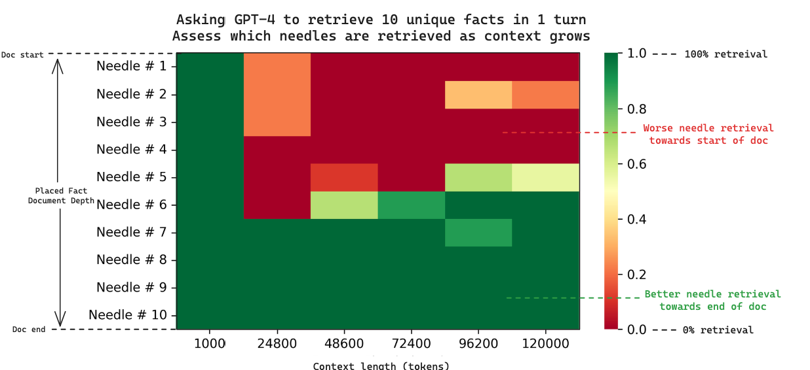
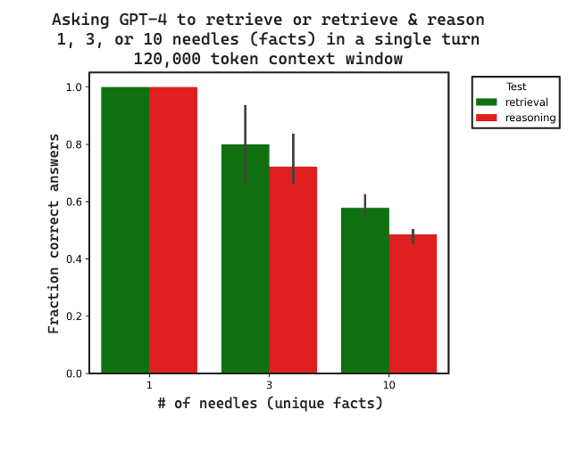

<!-- SDA-AIE-311 ADD (LangChain conversion) -->

# A. Context Engineering {.sdaia-dark background-gradient="linear-gradient(135deg, #1C355E, #00C9A7)"}

Stateful agents start here

## Agenda

- **A. Context Engineering** — the discipline
- **B. Sessions (Short-Term Memory)** — events, state, persistence
- **C. Long Context** — compaction strategies, mid-conversation model switching
- **D. Memory** — long-term, cross-session
- **E. Memory Pipeline** — extract, consolidate, retrieve
- **F. Procedural Memory** — self-improving agents
- **G. Production & Eval** — async, security, metrics
- **H. PDPL** — naming the law behind the controls <!-- SDA-AIE-311 ADD (G5) -->
- **I. Wrap-up** — key takeaways

## From Prompt Engineering to Context Engineering

> *Recall from API & Provider Landscape: every turn, you re-send the entire `messages` list. That re-send is the constraint Context Engineering responds to.*

:::: {.columns}

::: {.column width="50%"}
**Prompt Engineering**

- Crafts a *static* system prompt
- Optimizes wording, examples, format
- Pays off once, used everywhere
- Necessary, not sufficient
:::

::: {.column width="50%"}
**Context Engineering**

- *Dynamically assembles* the entire payload
- Selects: history, memories, tools, RAG hits
- Per-turn decisions on what to include
:::

::::

. . .

> **Context Engineering** is the *mise en place* of an agent: gather and prepare every ingredient before the model starts cooking.

## The Per-Turn Cycle

::: {.flow}
::: {.flow-step .accent-navy}
[User Query]{.t}
:::
::: {.flow-arrow}
&rarr;
:::
::: {.flow-step .accent-teal}
[Fetch]{.t}
[memories, RAG, history]{.s}
:::
::: {.flow-arrow}
&rarr;
:::
::: {.flow-step .accent-purple}
[Prepare]{.t}
[assemble payload]{.s}
:::
::: {.flow-arrow}
&rarr;
:::
::: {.flow-step .accent-orange}
[Invoke]{.t}
[LLM + tools]{.s}
:::
::: {.flow-arrow}
&rarr;
:::
:::: {.flow-branch}
::: {.flow-step .accent-navy}
[Response]{.t}
:::
::: {.flow-step .accent-purple}
[Upload]{.t}
[async &middot; persist new state]{.s}
:::
::::
:::

- **Fetch** and **Prepare** are blocking — the LLM call cannot start until context is ready
- **Upload** runs async — never make the user wait for memory writes

# B. Sessions (Short-Term Memory) {.sdaia-dark background-gradient="linear-gradient(135deg, #1C355E, #9B8EC0)"}

The container for one conversation

## What a Session Holds

A **session** (Short-Term Memory) is one continuous conversation, scoped to one user.

:::: {.columns}

::: {.column width="50%"}
**Events** (The `messages` list)

- `user` input (text/image/audio)
- `assistant` response
- `tool_call` — agent decides to use a tool
- `tool_output` — the tool's result
:::

::: {.column width="50%"}
**State** (working memory / scratchpad)

- Items in a shopping cart
- Form fields collected so far
- Intermediate calculations
- Anything *transient* to this conversation
:::

::::

. . .

> Events are append-only. State is mutable.

## The Familiar Shape

You already know this from API & Provider Landscape:

```python
from langchain_core.messages import AIMessage, HumanMessage, SystemMessage
from langchain_openai import ChatOpenAI

events = [
    SystemMessage(content="You are a helpful assistant."),
    HumanMessage(content="What's the capital of France?"),
    AIMessage(content="Paris."),
    HumanMessage(content="And its population?"),
]

llm = ChatOpenAI(model="gpt-4o-mini", temperature=0)
response = llm.invoke(events)
```

. . .

This is the **events** half of a session. The **state** half (cart contents, form fields, intermediate results) lives alongside it — managed by your code, not the LLM.

## Stateless Runtime → Persistent Store {.smaller}

In production, your agent process is typically stateless (containers restart, requests load-balance). The session must live somewhere durable.

::: {.lanes style="grid-template-columns: repeat(4, 1fr)"}
[User]{.lane-actor}
[Agent (stateless)]{.lane-actor}
[Session Store (Redis / Postgres / etc.)]{.lane-actor}
[LLM]{.lane-actor}
[turn N]{.lane-msg style="--from:1; --to:2"}
[load events + state]{.lane-msg style="--from:2; --to:3"}
[events list + state dict]{.lane-msg .reply style="--from:2; --to:3"}
[call LLM]{.lane-msg style="--from:2; --to:4"}
[response]{.lane-msg .reply style="--from:2; --to:4"}
[append event &middot; update state]{.lane-msg style="--from:2; --to:3"}
[reply]{.lane-msg .reply style="--from:1; --to:2"}
:::

. . .

::: {.callout-note}
Managed services like LangGraph checkpoints, Vertex Agent Engine Sessions, or your own table in Postgres all serve this role. The framework choice is implementation detail — the *concept* is what matters.
:::

## Session: A Minimal Implementation {.smaller}

```python
class Session:
    def __init__(self, session_id: str, store):
        self.session_id = session_id
        self.store = store  # any KV-style backend

    # ── Events (append-only) ──────────────────────
    def events(self) -> list[dict]:
        return self.store.get(f"{self.session_id}:events", default=[])

    def append(self, event: dict) -> None:
        events = self.events()
        events.append(event)
        self.store.set(f"{self.session_id}:events", events)

    # ── State (mutable scratchpad) ────────────────
    def get_state(self, key: str, default=None):
        state = self.store.get(f"{self.session_id}:state", default={})
        return state.get(key, default)

    def set_state(self, key: str, value) -> None:
        state = self.store.get(f"{self.session_id}:state", default={})
        state[key] = value
        self.store.set(f"{self.session_id}:state", state)
```

. . .

::: {.callout-important}
## Deterministic Order
Concurrent turns must be serialized — out-of-order events corrupt the conversation. Use transactional writes or per-session locks.
:::

## Session Security

A session can contain anything the user said — names, emails, account numbers, free-form personal stories.

| Concern | Practice |
|:--------|:---------|
| **Strict isolation** | Every read enforces `session.owner == request.user` (ACLs) |
| **PII redaction** | Redact *before* writing to the store, not just before display |
| **Audit log** | Track who read what, when |

. . .

> [Guardrails: Input & Output Defense](../slides/input_output_guardrails.html#pii-redaction) covers output-time PII redaction. Sessions need PII redaction at **write time** too — a leaked session log re-exposes everything.

# C. Managing Long Context {.sdaia-dark background-gradient="linear-gradient(135deg, #1C355E, #FF7A5C)"}

Why context windows matter, and how to compact them.

## Context Windows & Your API Bill

::: {.callout-important}
## `128K context ≠ 128K tokens free`
Every token in your context window is **charged on every request** — both the history you send and the reply you receive.
:::

**KV-cache intuition:** The API caches the mathematical representation of previous tokens so each new word generated is cheap. But the cache lives in GPU memory — and the context window is its size limit.

. . .

| Context length | Tokens processed (≈ billed cost) |
|---|---|
| 1K tokens | 1× |
| 8K tokens | 8× |
| 128K tokens | 128× |


## Performance: The Needle in the Haystack



- **Lost in the Middle** ([Liu et al., 2023](https://arxiv.org/abs/2307.03172)): LLMs often ignore facts buried in the middle.
- **Recall Degradation**: As context grows, retrieval ability drops.
- **Placement Matters**: Put crucial info at the **start** or **end**.

::: {.notes}
* **Needle in the Haystack (NIAH)**: A classic benchmark testing if a model can retrieve a single target fact ("needle") hidden inside a massive block of filler text ("haystack").
* **Lost in the Middle**: The heatmap visually represents recall accuracy (green is high, red/yellow is low). Models exhibit a strong primacy/recency bias. They remember facts at the very beginning (start of the prompt) or very end (right before generation) but struggle with details in the middle.
* **Recall Degradation**: Recall drops not just due to position, but also due to the total volume of context. The larger the haystack, the lower the recall, even if the model's token limit is technically larger.
* **Instructor Insight**: Emphasize that context window size (e.g., 128k or 1M) is a capacity metric, not an attention/accuracy metric. Dynamic context placement is essential in production.
:::

::: {.footer}
Sources: [Liu et al., 2023 — *Lost in the Middle*](https://arxiv.org/abs/2307.03172) · [LangChain Multi-Needle Analysis](https://blog.langchain.com/multi-needle-in-a-haystack/)
:::

## Multi-Needle & Reasoning Challenges {.smaller}

:::: {.columns}

::: {.column width="25%"}
**Retrieval is the Upper Bound**

1. **Fact Volume**: Retrieval accuracy drops significantly as the number of "needles" (facts) increases.
2. **Reasoning Penalty**: Asking the model to *think* about multiple retrieved facts is harder than just finding them.
3. **Upper Bound**: If the model can't retrieve it, it can't reason about it.
:::

::: {.column width="75%"}

:::

::::

::: {.notes}
* **Multi-Needle Challenge**: Real RAG workloads rarely need only one fact. Usually, the model must retrieve multiple independent facts (e.g., "Find all three times the system crashed"). As the number of needles increases, retrieval accuracy drops drastically.
* **Reasoning Penalty**: The heatmap/chart compares simple retrieval of multiple needles versus asking the model to perform reasoning/logic over those retrieved facts. Reasoning introduces a massive performance penalty.
* **Retrieval is the Upper Bound**: This is the most crucial concept. If the model fails to retrieve even one of the required facts, it has zero chance of reasoning over it. Downstream reasoning fails when upstream retrieval fails.
* **Instructor Insight**: Highlight that relying on massive context windows for complex reasoning is fragile. A better pattern is context compaction, parallel sub-queries, or prompting the model to explicitly list retrieved facts before synthesizing.
:::

::: {.footer}
Source: [LangChain Multi-Needle Analysis](https://blog.langchain.com/multi-needle-in-a-haystack/)
:::

## Key Levers of Context Optimization


::: {.incremental}

> *Given the cost and "Lost in the Middle" effects of long context, we need strategies to keep the payload tight.*

- **1. History Compaction**: Shrink or summarize the conversation history (e.g., sliding window, recursive summarization).
- **2. Context Pruning (RAG)**: Filter retrieved knowledge to only send relevant snippets, not entire documents.
:::

::: {.callout-tip .fragment}
## Real-Time Cost Tracking
Use LangChain (ChatOpenAI)'s built-in usage tracking (e.g. `response.usage_metadata`) to monitor API costs in real-time during development.
:::

## History Compaction Strategies


| Strategy | What it does | Trade-off |
|:---------|:-------------|:----------|
| **Sliding window (last N)** | Keep last N turns, drop the rest | Simple, can lose early context |
| **Token truncation** | Keep most recent messages until token cap | Preserves recency, hard cutoff |
| **Recursive summarization** | LLM-summarize old turns; prepend summary | Preserves meaning, adds an LLM call |
| **Hybrid** | Summary of old + verbatim of recent | Best quality, most complex |

. . .

::: {.callout-note}
## In the wild: Hermes
[Hermes' `context_compressor`](https://hermes-agent.nousresearch.com/docs/developer-guide/context-compression-and-caching/)  summarizes the **middle** turns — keeping head and tail verbatim. A direct application of "Lost in the Middle": compress where the model attends *least*.
:::

## Sliding Window (Simple)

```python
def trim_to_last_n(events: list[dict], n: int = 10) -> list[dict]:
    """Keep system message + last n turns."""
    system = [e for e in events if e["role"] == "system"]
    rest   = [e for e in events if e["role"] != "system"]
    return system + rest[-n:]


# Use during context preparation, not when storing
context = trim_to_last_n(session.events(), n=10)
messages = [SystemMessage(content=e["content"]) if e["role"] == "system"
            else HumanMessage(content=e["content"]) if e["role"] == "user"
            else AIMessage(content=e["content"]) for e in context]
response = ChatOpenAI(model="gpt-4o", temperature=0).invoke(messages)
```

. . .

::: {.callout-important}
## Trim the Payload, Not the Store
Storage is cheap; tokens are expensive. Keep the full session history persisted — only compact what you *send* to the model.
:::

## Recursive Summarization {.smaller}

```python
SUMMARIZE_PROMPT = """Summarize this conversation.
Preserve facts, decisions, and open questions."""

def compact(events: list[dict], keep_recent: int = 6) -> list[dict]:
    if len(events) <= keep_recent:
        return events

    old, recent = events[:-keep_recent], events[-keep_recent:]

    summary = ChatOpenAI(
            model="gpt-4o-mini",  # cheap model is fine for summaries
            temperature=0,
        ).invoke([
            SystemMessage(content=SUMMARIZE_PROMPT),
            HumanMessage(content=str(old)),
        ]).content

    return [{"role": "system", "content": f"Earlier conversation summary:\n{summary}"}] + recent
```

. . .

> Run this **asynchronously** between turns. The next turn just reads the cached compacted version.

## When to Compact

| Trigger | When it fires | Best for |
|:--------|:--------------|:---------|
| **Count-based** | Token / turn count crosses threshold | Bursty, predictable workloads |
| **Time-based** | User idle for *N* minutes | Long-running advisor agents |
| **Event-based** | Sub-task / topic completes | Task-oriented agents |

. . .

::: {.callout-tip}
## Default to Count-Based
Cheapest to implement, "good enough" for most agents. Add sophistication only when you have data showing it's needed.
:::

## Beyond Compaction: Context as an Environment

Compaction and pruning *throw context away* to dodge "Lost in the Middle." A frontier alternative flips the framing: **keep all of it, and let the model query it with code.**

. . .

**Recursive Language Models (RLMs)** — instead of feeding a giant prompt into the transformer:

::: {.incremental}
1. The full prompt is loaded as a **variable in a Python REPL** — part of the *environment*, not the attention window.
2. The **root LLM writes code** to inspect it — regex filters, chunking, slicing — to find what matters.
3. It **recursively calls sub-LLMs** on those slices, then aggregates their answers.
:::

::: {.notes}
* The core trick: the model never attends over the whole haystack at once, so it sidesteps the token-level degradation ("context rot") from the Lost-in-the-Middle slide. Attention quality is preserved because each sub-call sees a small, relevant slice.
* "Recursive" because the root model invokes the *same* capability on sub-tasks — in the paper's experiments GPT-5 is the root and GPT-5-mini handles sub-calls.
* Contrast with RAG: RAG retrieves before the model runs; here the model itself decides how to navigate the full text programmatically, mid-reasoning.
:::

## Beyond Compaction: Context as an Environment (II) {.smaller}

::: {.flow}
::: {.flow-step .accent-navy}
[Long context]{.t}
[10M+ tokens]{.s}
:::
::: {.flow-arrow}
&rarr;
[load as variable]{.s}
:::
::: {.flow-step .accent-purple}
[Python REPL]{.t}
:::
::: {.flow-arrow}
&rarr;
:::
::: {.flow-step .accent-teal}
[Root LLM]{.t}
[writes code]{.s}
:::
::: {.flow-arrow}
&rarr;
[slice / filter]{.s}
:::
::: {.flow-step}
[Relevant chunks]{.t}
:::
::: {.flow-arrow}
&rarr;
[recurse]{.s}
:::
::: {.flow-step .accent-orange}
[Sub-LLM calls]{.t}
:::
::: {.flow-arrow}
&rarr;
:::
::: {.flow-step .accent-navy}
[Aggregate &rarr; Answer]{.t}
:::
:::

::: {.center}
[&#8635; iterate &middot; Root LLM &rarr; Python REPL]{.pill}
:::

. . .

**Why it matters:** on long-document retrieval (BrowseComp-Plus, millions of tokens), the base model simply *can't fit the input* — while the RLM scales to inputs ~2 orders of magnitude past the context window, often at **lower median cost** than one stuffed call.

| Trade-off | Detail |
|:---|:---|
| **Worse on short inputs** | A direct call wins below a crossover length — only pays off when context is huge |
| **High cost variance** | Runaway trajectories can cost far more than one call |
| **Slower** | Sub-calls run sequentially today |
| **Not trained for it** | Models navigate their own context inefficiently |

::: {.callout-note}
## Same word, opposite philosophy
*Recursive summarization* (earlier) is **lossy** — one cheap pass that discards detail. RLM is **lossless navigation** — it keeps everything and pays per query. A 2025 preprint and frontier technique, not yet settled practice.
:::

::: {.footer}
Source: [Zhang, Kraska & Khattab — *Recursive Language Models* (arXiv:2512.24601, 2025)](https://arxiv.org/abs/2512.24601)
:::

## Prefix Stability: The Cache's One Rule {#prefix-stability}

The KV cache matches from the **front** and stops at the first difference: a hit requires the prefix to be **byte-identical** to a previous turn.

. . .

So *where* you place content matters as much as *how much* you send:

| Position | Holds | On a change |
|:---|:---|:---|
| **Stable prefix** | system prompt, durable memory, tool list | Cached — reused every turn |
| **Volatile tail** | latest user turn, fresh retrieval | Re-encoded every turn (cheap — it's small) |

. . .

Change one token early — swap a memory, reorder the tool list — and **every token after it re-prefills at full cost**. The lever: keep volatile content at the *end* and treat the prefix as frozen.

::: {.callout-tip}
## Foreshadow: a production consequence
Hermes Agent (§3) pushes this to its conclusion — it *freezes* injected memory at session start to keep the prefix a stable cache key, accepting some staleness to keep the hit. Same rule, all the way.
:::


## Switching Models Mid-Conversation Breaks the Cache

The "Opus for planning, Sonnet for execution" dropdown looks free — but the KV cache is **provider-and model-specific**, so the first turn after the switch pays the full context cost ([Prefix Stability](#prefix-stability)).

| Cost surface | Same-model turn | First turn after switch |
|:---|:---|:---|
| KV cache | Hit | **Miss** — full prefill |
| Tool-call shape in history | In-distribution | **Out-of-distribution** |
| First-token latency | Low | High |
| Risk of re-invoking another model's tools | None | Real |

. . .

::: {.callout-tip}
## Practical recommendation
Stay with **one model** for the duration of a conversation unless you have a concrete reason to switch. If you must switch, inject a system note: *"You just took over from another model. Some tool calls in this history are not yours — do not re-invoke them."* Cursor, for example, ships this mitigation.
:::

::: {.footer}
Source: [Cursor — *Continually Improving Our Agent Harness*](https://cursor.com/blog/continually-improving-agent-harness)
:::


# D. Memory {.sdaia-dark background-gradient="linear-gradient(135deg, #1C355E, #9B8EC0)"}

Long-term, cross-session

## Sessions vs Memory

:::: {.columns}

::: {.column width="50%"}
**Session (Short-Term Memory)**

- One conversation
- Raw events, verbatim
- Append-only log
- Lives & dies with the conversation
:::

::: {.column width="50%"}
**Memory (Long-Term)**

- Spans *all* the user's conversations
- Distilled, processed insights
- Curated (created, updated, deleted)
- Persists across sessions, forever (or until pruned)
:::

::::

. . .

> Session = the messy desk during the project. Memory = the filing cabinet you sort into when the project is done.

## What Memory Unlocks

::: {.incremental}
- **Personalization** — remember the user's preferences, history, goals
- **Context window relief** — distill 50 sessions into 10 facts
- **Self-improvement** — record which strategies worked (procedural memory)
- **Cross-user insight** — aggregated, anonymized signal across users
:::

## Two Types of Memory

Borrowed from cognitive science:

| Type | Answers | Example |
|:-----|:--------|:--------|
| **Declarative** | "What?" | "User prefers window seats." |
| **Procedural** | "How?" | "When booking flights, search direct first, fall back to one-stop." |

. . .

> Most memory systems today handle declarative memory. Procedural is the frontier — we'll come back to it in Section F.

## Memory Scope

Who does this memory describe?

| Scope | Example | Use |
|:------|:--------|:----|
| **User** | `"User prefers Arabic responses"` | Personalization (most common) |
| **Application** | `"Project codename ATLAS = Q4 launch"` | Shared facts for all users |

. . .

::: {.callout-important}
## Strict Isolation by Default
User-scoped memory must **never** leak across users. Application-scoped memory must be sanitized of any user PII.
:::

::: {.notes}
* **User Scope:** Persists forever. Crucial for long-term personalization. Requires strict database-level row isolation (ACLs).
* **Application Scope:** Shared across all users (e.g. system configurations, global facts). If updated dynamically by users, it is a high-risk vector for PII leaks or memory poisoning.
:::

## Memory Organization Patterns

Three common shapes:

:::: {.columns}

::: {.column width="33%"}
::: {.qbox style="border-top: 4px solid var(--sdaia-teal); background: rgba(0, 201, 167, 0.02); height: 100%; min-height: 440px; display: flex; flex-direction: column; justify-content: space-between; padding: 18px; box-shadow: 0 4px 12px rgba(0,0,0,0.03); margin-right: 5px;"}
<div>
<span class="pill" style="background: rgba(0, 201, 167, 0.12); border-color: rgba(0, 201, 167, 0.25); color: var(--sdaia-navy); font-size: 0.45em; text-transform: uppercase; font-weight: bold; letter-spacing: 0.05em; padding: 2px 8px;">Atomic Facts</span>
<h3 style="margin-top: 10px; margin-bottom: 5px; font-size: 0.85em; font-weight: 700; color: var(--sdaia-navy); border-bottom: none; padding-bottom: 0;">Collection</h3>
<p style="font-size: 0.65em; line-height: 1.35; color: var(--muted); margin-bottom: 12px;">Many small, independent facts.</p>

<div style="font-size: 0.72em; margin-bottom: 10px;">
```{.json code-line-numbers="false"}
[
  "Prefers window seat",
  "Vegetarian",
  "Lives in Riyadh"
]
```
</div>
</div>

<div style="font-size: 0.58em; color: var(--muted); border-top: 1px solid rgba(28, 53, 94, 0.1); padding-top: 8px; line-height: 1.35;">
🔍 **Lookup:** Semantic similarity search (covered in RAG).
</div>
:::
:::

::: {.column width="33%"}
::: {.qbox style="border-top: 4px solid var(--sdaia-purple); background: rgba(155, 142, 192, 0.02); height: 100%; min-height: 440px; display: flex; flex-direction: column; justify-content: space-between; padding: 18px; box-shadow: 0 4px 12px rgba(0,0,0,0.03); margin-left: 2px; margin-right: 2px;"}
<div>
<span class="pill" style="background: rgba(155, 142, 192, 0.12); border-color: rgba(155, 142, 192, 0.25); color: var(--sdaia-navy); font-size: 0.45em; text-transform: uppercase; font-weight: bold; letter-spacing: 0.05em; padding: 2px 8px;">Key-Value</span>
<h3 style="margin-top: 10px; margin-bottom: 5px; font-size: 0.85em; font-weight: 700; color: var(--sdaia-navy); border-bottom: none; padding-bottom: 0;">Structured Profile</h3>
<p style="font-size: 0.65em; line-height: 1.35; color: var(--muted); margin-bottom: 12px;">One record, many key-value fields.</p>

<div style="font-size: 0.72em; margin-bottom: 10px;">
```{.json code-line-numbers="false"}
{
  "seat":  "window",
  "diet":  "vegetarian",
  "city":  "Riyadh"
}
```
</div>
</div>

<div style="font-size: 0.58em; color: var(--muted); border-top: 1px solid rgba(28, 53, 94, 0.1); padding-top: 8px; line-height: 1.35;">
⚡ **Lookup:** Direct key lookup or exact field access.
</div>
:::
:::

::: {.column width="33%"}
::: {.qbox style="border-top: 4px solid var(--sdaia-orange); background: rgba(255, 122, 92, 0.02); height: 100%; min-height: 440px; display: flex; flex-direction: column; justify-content: space-between; padding: 18px; box-shadow: 0 4px 12px rgba(0,0,0,0.03); margin-left: 5px;"}
<div>
<span class="pill" style="background: rgba(255, 122, 92, 0.12); border-color: rgba(255, 122, 92, 0.25); color: var(--sdaia-navy); font-size: 0.45em; text-transform: uppercase; font-weight: bold; letter-spacing: 0.05em; padding: 2px 8px;">Narrative</span>
<h3 style="margin-top: 10px; margin-bottom: 5px; font-size: 0.85em; font-weight: 700; color: var(--sdaia-navy); border-bottom: none; padding-bottom: 0;">Rolling Summary</h3>
<p style="font-size: 0.65em; line-height: 1.35; color: var(--muted); margin-bottom: 12px;">One natural-language doc, continuously updated/rewritten.</p>

<div style="background: var(--sdaia-code-bg); border: 1px solid var(--sdaia-border); border-radius: 8px; padding: 12px; font-family: var(--font-family-monospace); font-size: 0.55em; line-height: 1.45; color: var(--text); min-height: 86px; display: flex; align-items: center; margin-bottom: 10px;">
"User is a vegetarian based in Riyadh who travels frequently and prefers window seats…"
</div>
</div>

<div style="font-size: 0.58em; color: var(--muted); border-top: 1px solid rgba(28, 53, 94, 0.1); padding-top: 8px; line-height: 1.35;">
🔄 **Lookup:** Whole-document context injection.
</div>
:::
:::

::::


## Where Memory Lives

These are the same storage families you saw in RAG. Here we focus on what's distinct about *memory* content.

| Storage | Strength | Weakness |
|:--------|:---------|:---------|
| **Vector DB** | Semantic similarity ("things conceptually like X") | No relational reasoning |
| **Knowledge graph** | "User → works_at → Company → in → City" | Heavy schema, slower setup |
| **Hybrid** | Graph nodes embedded as vectors | More moving parts |

. . .

> Same tooling you saw in RAG. The *content* and *update patterns* are what differ.

# E. The Memory Pipeline {#memory-pipeline .sdaia-dark background-gradient="linear-gradient(135deg, #1C355E, #FF7A5C)"}

Extract, consolidate, retrieve

## Memory Generation = LLM-Driven ETL {.smaller}

::: {.flow}
::: {.flow-step .accent-navy}
[Session events]{.t}
:::
::: {.flow-arrow}
&rarr;
[extract]{.s}
:::
::: {.flow-step .accent-teal}
[Raw memories]{.t}
:::
::: {.flow-arrow}
&rarr;
[compare with existing]{.s}
:::
::: {.flow-step .accent-purple}
[Consolidate]{.t}
:::
::: {.flow-arrow}
&rarr;
:::
:::: {.flow-branch}
::: {.flow-step}
[CREATE]{.t}
[new]{.s}
:::
::: {.flow-step}
[DELETE]{.t}
[contradicts]{.s}
:::
::: {.flow-step}
[UPDATE]{.t}
[refines]{.s}
:::
::::
::: {.flow-arrow}
&rarr;
:::
::: {.flow-step .accent-orange}
[Memory Store]{.t}
:::
:::

The LLM decides: *what's worth remembering, and how does it interact with what we already know?*

> **Influential early treatment:** [MemGPT: Towards LLMs as Operating Systems](https://arxiv.org/abs/2310.08560) (Packer et al., 2023) framed LLM memory as OS-style virtual-context paging. The extract → consolidate retrieval triad we score below traces more directly to [Generative Agents](https://arxiv.org/abs/2304.03442) (Park et al., 2023).

## Extraction {.smaller}

Filter the signal from the noise.

```python
from pydantic import BaseModel

class ExtractionResult(BaseModel):
    facts: list[str]

EXTRACT_PROMPT = """Read the conversation. Extract only durable facts about the user that
would be useful in a future session: preferences, goals, constraints, key context.

Ignore: greetings, jokes, transient state, restated facts."""

def extract(events: list[dict]) -> list[dict]:
    llm = ChatOpenAI(model="gpt-4o", temperature=0).with_structured_output(
        ExtractionResult)  # ← Pass the Pydantic schema
    parsed = llm.invoke([
        SystemMessage(content=EXTRACT_PROMPT),
        HumanMessage(content=str(events)),
    ])
    return [f.fact for f in parsed.facts]
```

. . .

> "Meaningful" is *application-specific*. A wellness coach extracts mood; a support agent extracts ticket numbers. Customize the prompt.

## Consolidation {.smaller}

Reconcile new extractions with what's already stored.

```python
CONSOLIDATE_PROMPT = """Existing memories: {existing}
New extracted facts: {new}

For each new fact, decide:
- CREATE if novel
- UPDATE <id> if it refines an existing memory
- DELETE <id> if it contradicts and supersedes one

Return JSON list of operations."""
```

. . .

| Operation | Trigger |
|:----------|:--------|
| **CREATE** | Topic is new |
| **UPDATE** | Same topic, more nuance ("interested in marketing" → "leads marketing for Q4 launch") |
| **DELETE** | Direct contradiction or invalidation |

::: {.callout-important}
## Without Consolidation
You get a noisy, contradictory log of every fact ever mentioned — *worse* than no memory at all.
:::

## When to Generate Memory

| Strategy | Cost | Freshness |
|:---------|:-----|:----------|
| **Every turn** | Highest | Most current |
| **Every N turns** | Medium | Lags by *N* turns |
| **At session end** | Lowest | One batch per session |
| **Memory-as-a-tool** | Variable | Agent decides — most flexible |

. . .

> **Default:** at session end, in the background. Use *memory-as-a-tool* when the agent should decide ("user just said 'remember this'").


## Memory-as-a-Tool

Expose memory writes as a tool the agent can call.

```python
def remember(fact: str, scope: str = "user") -> dict:
    """Persist a durable fact about the user.
    Use when the user says 'remember', or when they share a stable
    preference, goal, or constraint worth recalling later."""
    memory_store.upsert(user_id=current_user, fact=fact, scope=scope)
    return {"status": "ok"}

agent_tools = [search, calculate, remember]  # add to ReactAgent's toolkit
```

## Memory Provenance

Track *where* each memory came from.

| Source | Trust |
|:-------|:------|
| **Bootstrapped** (CRM, signup form) | Highest — solves cold-start |
| **User explicit** ("remember my anniversary is…") | High |
| **User implicit** (inferred from chat) | Medium |
| **Tool output** (cached API response) | Low — stale fast |

. . .

When sources conflict, the **highest-trust + most-recent** wins. Without provenance, you can't resolve conflicts at all.

## Retrieval

RAG (which you saw earlier) ranks retrieval by *relevance* (topical similarity) alone. Memory retrieval needs two extra dimensions **(Recency, Importance)** on top of that — the triad introduced by [Generative Agents](https://arxiv.org/abs/2304.03442) (Park et al., 2023):

. . .

| Dimension | What it asks |
|:----------|:-------------|
| **Relevance** | Is this memory topically related to the current turn? |
| **Recency** | How recently was this captured? |
| **Importance** | How significant was this memory at generation time? |

. . .

```text
# Weights are starting points, tune them.
score = 0.6 × relevance + 0.2 × recency + 0.2 × importance
```

::: {.callout-warning}
## Put the three on the same scale *first*
You can use **Min-max normalization** to normalize each component across the candidate set before weighting.
:::


## Where Retrieved Memory Goes

Two placement options, with different trade-offs:

:::: {.columns}

::: {.column width="50%"}
**System prompt**

```
You are an assistant.
Known about user:
- Prefers Arabic
- Vegetarian
```

- High authority
- Always present
- Can over-influence ("everything is about food")
:::

::: {.column width="50%"}
**Dialogue injection / tool**

Retrieved as a tool result, mid-conversation.

- Only when relevant
- Lower over-influence risk
- Risk of *dialogue injection*: model may treat it as something the user said
:::

::::

. . .

> **Hybrid:** stable global facts (profile) in system prompt; episodic facts retrieved as needed.

# F. Procedural Memory {#procedural-memory .sdaia-dark background-gradient="linear-gradient(135deg, #1C355E, #00C9A7)"}

Self-improving agents

## Procedural ≠ Declarative

| | Declarative | Procedural |
|:---|:---|:---|
| Stores | Facts | Strategies / playbooks |
| Source | What the user said | What worked in past runs |
| Use | "Insert into context as evidence" | "Follow this approach for tasks like X" |

## The Self-Improvement Loop {.smaller}

::: {.flow}
::: {.flow-step .accent-navy}
[Agent attempts task]{.t}
:::
::: {.flow-arrow}
&rarr;
:::
::: {.flow-step .accent-orange}
[Outcome]{.t}
:::
::: {.flow-arrow}
&rarr;
:::
:::: {.flow-branch}
::: {.flow-step}
[Extract]{.t}
[success &middot; winning strategy]{.s}
:::
::: {.flow-step}
[Extract]{.t}
[failure &middot; failure mode]{.s}
:::
::::
::: {.flow-arrow}
&rarr;
:::
::: {.flow-step .accent-teal}
[Procedural Memory]{.t}
[playbook]{.s}
:::
:::

::: {.center}
[&#8635; retrieve relevant playbook &middot; back to the Agent]{.pill}
:::

. . .

> Each successful run leaves the agent slightly better at the *next* run, without retraining a single weight.

::: {.callout-warning}
## Failure mode
Procedural memory entries are themselves LLM-generated — a bad playbook persists and re-corrupts every future run. Always score, version, and gate writes behind a success-rate threshold; "self-improving" agents that write unconditionally tend to drift, not learn.
:::

::: {.footer}
Key Research: [**Reflexion** (Shinn et al., 2023)](https://arxiv.org/abs/2303.11366) — verbal reinforcement · [**VOYAGER** (Wang et al., 2023)](https://arxiv.org/abs/2305.16291) — skill libraries (procedural memory)
:::

## Fine-Tuning vs Procedural Memory

| | Fine-Tuning | Procedural Memory |
|:---|:---|:---|
| Mechanism | Updates model weights | Injects a playbook into the prompt |
| Setup | Slow, offline, requires labeled data | Fast, online, autonomous |
| Reversibility | Hard | Trivial (delete the memory) |
| Per-user customization | Expensive | Free |

. . .

::: {.callout-tip}
## In-Context Learning Wins for Personalization
Fine-tuning is right for global behavior changes. Procedural memory is right when the "right" approach varies per user, per task, or per week.
:::

# G. Production & Evaluation {#production-evaluation .sdaia-dark background-gradient="linear-gradient(135deg, #1C355E, #FF7A5C)"}

What changes at scale

## Async Pipeline

::: {.flow}
::: {.flow-step .accent-navy}
[Agent replies]{.t}
:::
:::: {.flow-branch}
::: {.flow}
::: {.flow-arrow}
&rarr;
:::
::: {.flow-step .accent-teal}
[User]{.t}
:::
:::
::: {.flow}
::: {.flow-arrow .dashed}
&#8674;
[non-blocking]{.s}
:::
::: {.flow-step .accent-purple}
[Memory Service]{.t}
:::
::: {.flow-arrow}
&rarr;
:::
::: {.flow-step}
[Extract]{.t}
:::
::: {.flow-arrow}
&rarr;
:::
::: {.flow-step}
[Consolidate]{.t}
:::
::: {.flow-arrow}
&rarr;
:::
::: {.flow-step .accent-orange}
[Memory Store]{.t}
:::
:::
::::
:::

. . .

::: {.callout-important}
## Never Block on Memory Writes
Memory generation costs an LLM call. Blocking the user's reply on it adds 1–3 seconds of pure latency for *no* user-visible benefit.
:::


## Production Concerns

| Concern | What to do |
|:--------|:-----------|
| **Concurrency** | Optimistic locking on per-memory updates; queue heavy generation |
| **Failure handling** | Retry with exponential backoff; dead-letter for repeated failures |
| **Multi-region** | Memory store needs replication — consolidation requires consistent reads |
| **Privacy** | Per-user ACLs; PII redaction *before* persistence; opt-out for memory generation; honor **delete-on-request** (GDPR-style targeted erasure of a user's memories) |
| **Memory poisoning** | Malicious user input → "fact" extracted → poisons future turns. Sanitize at write time. |
| **Embedding drift** | Stored vectors go stale if you change the embedding model — keep the embedder versioned, and re-embed the store on upgrade |

## Evaluation: Measure the Lift, Not the Fact Count

You already have the eval machinery from **RAG evaluation** — memory reuses all of it:

- **Extraction** is graded like generation — precision / recall of captured facts vs a golden set
- **Retrieval** is graded like RAG — Recall@K, latency

. . .

But those are **leading indicators**. The headline question is whether memory changes outcomes:

> Measure memory by **task-success lift** — not by counting facts.

. . .

## Evaluation: Ablation vs. A/B Testing

### Prove it once, then A/B the *config*
Memory isn't free — tokens, latency, poisoning, over-influence — so the lift is **not** guaranteed.

1. **Justify it once** with a memory-on vs memory-off **ablation**: replay your golden sessions with the pipeline wired in vs stubbed out.
2. **After that, on/off retires.** A/B the *configuration* instead — injection placement, recency/importance weights, extraction cadence.

[Observability & Evaluation](../slides/observability_and_evaluation.html) will frame Task Success Rate as the headline agent metric; this is its memory-specific instance.

# H. Name the Law You Are Implementing <!-- SDA-AIE-311 ADD (G5) --> {.sdaia-dark background-gradient="linear-gradient(135deg, #1C355E, #9B8EC0)"}

The controls above have a legal name in Saudi Arabia

## PDPL: The Mechanisms You Built Are Compliance {.smaller}

<!-- SDA-AIE-311 ADD (G5) -->

Everything on the previous slides — per-user ACLs, isolation by default, write-time PII redaction, delete-on-request erasure — is how you satisfy **Saudi Arabia's Personal Data Protection Law (PDPL)** and its implementing regulations, enforced by **SDAIA's National Data Management Office (NDMO)**.

| PDPL obligation (in plain terms) | The engineering control you already have |
|:----------------------------------|:-------------------------------------------|
| Lawful basis + notice for collecting personal data | Consent flag at ingestion; memory opt-out switch |
| Data minimisation | Extract only needed facts; redact PII *before* persistence |
| Access control | Strict per-user isolation, ACLs at the row level |
| Correction & deletion on request | `forget_customer`-style erasure across vectors **and** checkpoints |
| Breach notification | Audit log: who read/wrote which memory, when |

. . .

::: {.callout-important}
## Naming it changes the conversation
"Should memory be isolated per user?" is an architecture question. "PDPL requires that personal data be access-controlled and erasable" makes it a **requirement** — and you, in this room, are the people who write the controls. Build them into the harness, not the model's good intentions.
:::

::: {.callout-note}
Check the current text of the law and NDMO controls before using this slide in a compliance context — regulations are revised; this slide teaches the mapping, not legal advice.
:::

# I. Wrap-up {.sdaia-dark background-gradient="linear-gradient(135deg, #1C355E, #00C9A7)"}

## Key Takeaways

1. **LLMs are stateless.** Context Engineering is the discipline of building the *right* payload every turn.
2. **Sessions** = one conversation, events + state, persisted in a durable store.
3. **Context Windows** are expensive and performance-bound—be strategic about what you include.
4. **Compact what you send, not what you store.** Sliding window, token cap, recursive summary.
5. **Memory** = cross-session, distilled. Declarative for facts, procedural for playbooks.
6. **Memory pipeline** = extract → consolidate (CREATE/UPDATE/DELETE) → store → retrieve.
7. **Always async, always isolated, always evaluated.**

## Further Reading & Foundational Research

- [**Context Engineering: Sessions & Memory**](https://www.kaggle.com/whitepaper-context-engineering-sessions-and-memory) — Kimberly Milam & Antonio Gulli, Google, Nov 2025
- **Generative Agents** (Park et al., 2023) — *Seminal work on memory streams and scoring.*
- **MemGPT** (Packer et al., 2023) — *Foundational "LLMs as OS" architecture for stateful agents.*
- **Reflexion & Voyager** (2023) — *Key papers for self-improving agents and procedural memory.*
- [**Recursive Language Models**](https://arxiv.org/abs/2512.24601) (Zhang, Kraska & Khattab, 2025) — *Treat long context as a navigable environment instead of compacting it.*

. . .

### Tooling
- LangGraph: state-as-session pattern
- Vertex Agent Engine: Sessions & Memory Bank (managed)
- Mem0, Zep: open memory managers

